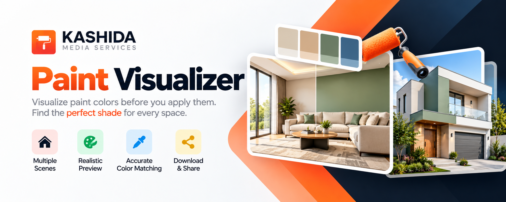
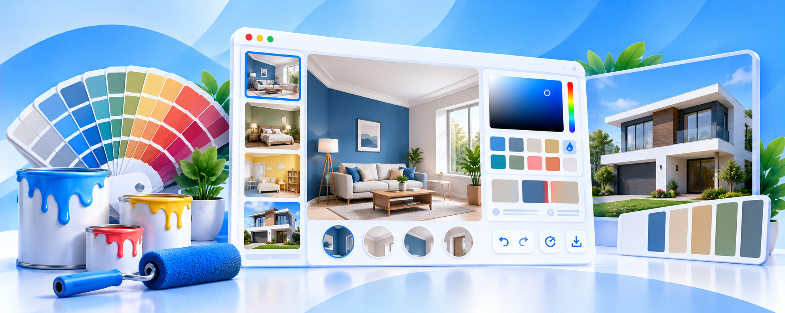

# Kashida Paint Visualizer

### Visualize Colors. Transform Spaces.

An advanced interactive WordPress paint visualizer that helps visitors preview paint colors on interior spaces and exterior facades, experiment with color combinations, and compare results before making a decision.

  <a href="https://kashida.ly/wp-plugins/paint-visualizer/kashida-paint-visualizer/" target="_blank" rel="noopener noreferrer"><strong>▶ Try the Live Demo</strong></a>
  &nbsp; · &nbsp;
  <a href="https://kashida.ly/wp-plugins/paint-visualizer/" target="_blank" rel="noopener noreferrer"><strong>Plugin Details</strong></a>
  &nbsp; · &nbsp;
  <a href="https://kashida.ly/contact/" target="_blank" rel="noopener noreferrer"><strong>Request a Quote</strong></a>

**Version 1.5.0 · Developed by Kashida Media Services**

---

## Overview

Kashida Paint Visualizer is an advanced, interactive WordPress plugin that allows website visitors to preview paint colors on interior rooms and exterior house facades. With precise paintable regions and flexible color selection tools, users can experiment with different combinations and visualize their choices directly on your website.

The visualizer includes five scenes, an interactive color palette, optional integration with Kashida Color Library, a draggable before-and-after divider directly on the image, undo and redo controls, and high-quality image export and sharing. Version 1.5.0 adds a Company Catalog color source that reads published, enabled color groups from Kashida Color Library 2.7.0, with catalog search and pagination. The built-in visualizer palette remains available independently whenever the catalog plugin is unavailable or the catalog cannot be loaded. The visualizer also benefits from the mobile, interface, and theme-font improvements introduced in version 1.4.1.

**This is a product showcase repository.** It contains product information and promotional images only. It does not include the plugin source code or an installation package.

## Key Features

| Feature | Description |
| --- | --- |
| **Five visualization scenes** | Explore Living Room, Bedroom, Kids Room, Kitchen, and Exterior House scenes. |
| **Independent paintable regions** | Apply different colors to designated walls, ceilings, kitchen cabinets, and other paintable areas independently. |
| **Advanced color selection** | Choose colors freely or enter exact HEX, RGB, and CMYK values. |
| **Interactive color palette** | Search colors, filter by color families, save favorites, and revisit recently used colors. |
| **Company Catalog integration** | Optionally connect to Kashida Color Library 2.7.0 and select colors from published, enabled company color groups. |
| **Catalog search and pagination** | Browse large company color groups with search by color name, code, or HEX value and paginated results. |
| **Independent built-in palette** | Keep using the visualizer's built-in colors when Kashida Color Library is not installed, is inactive, has no available groups, or its API is temporarily unavailable. |
| **Before & After comparison** | Compare the original scene with the painted result using a draggable divider placed directly on the image, without a separate percentage control. |
| **Undo, redo, and reset** | Review color changes, restore previous steps, and reset the scene. |
| **High-quality image export** | Download completed visualizations as PNG images. |
| **Native image sharing** | Share finished designs using sharing options supported by the device and browser. |
| **Improved mobile experience** | Refined the mobile layout and interaction experience for smaller screens. |
| **UI refinements** | Improved interface presentation and usability for a clearer, more consistent workflow. |
| **Responsive workspace** | Use the visualizer on desktop, tablet, and mobile, with an optional full-width workspace. |
| **WordPress theme integration** | Automatically inherit the active WordPress theme's font, maintaining a consistent typographic appearance. |
| **Server-side rendering** | Process paint effects and region hit-testing using PHP/GD, keeping mask assets and rendering logic on the server. |
| **Optimized performance** | Benefit from optimized pixel processing, cached region data, and WebP previews where supported, with PNG fallback. |
| **Privacy-conscious workflow** | Customer designs and color selections are not saved as server-side user designs or stored in the WordPress database. Catalog integration reads public color catalog data only. |
| **Multilingual support** | Arabic translation is included, with a POT template for additional languages. |

## Product Preview

## Preview the Interface

### Paint Visualizer Dashboard

### Multiple Ways to Choose Colors

### Interior Scene Preview

### Designed for WordPress

### Share and Export

## Use Cases

Kashida Paint Visualizer is designed for businesses and professionals working in the paint, construction, and interior design industries.

- **Paint manufacturers and brands:** Showcase paint collections through interactive interior and exterior scenes.
- **Paint retailers and distributors:** Help customers preview colors before choosing products.
- **Interior designers and decorators:** Experiment with wall and ceiling color combinations and present visual concepts to clients.
- **Construction and real estate companies:** Demonstrate exterior facade options and interior finishing choices.
- **E-commerce paint stores:** Add an interactive color preview experience to product websites.
- **Showrooms and marketing teams:** Present paint collections through interactive demonstrations and digital displays.

## Plugin Details

- **Plugin:** Kashida Paint Visualizer
- **Version:** 1.5.0
- **Developer:** Kashida Media Services
- **Author:** Mrwan elGobee
- **Platform:** WordPress
- **Requires WordPress:** 5.8 or later
- **Tested up to:** WordPress 7.1
- **Requires PHP:** 8.0 or later
- **Server requirement:** PHP GD extension enabled
- **Shortcode**
- **Scenes:** 5
- **Optional catalog integration:** Kashida Color Library 2.7.0 or later
- **Preview formats:** WebP where supported, with PNG fallback
- **Export format:** PNG
- **Languages:** Arabic and English
- **Translation files:** POT / PO / MO
- **License:** GPLv2 or later
- **Availability:** Commercial product; pricing and licensing information upon request

## Installation and Usage

This repository does not contain an installable plugin package. After obtaining the plugin package from Kashida Media Services:

1. In WordPress, go to **Plugins → Add New Plugin → Upload Plugin**.
2. Upload the plugin ZIP file and activate **Kashida Paint Visualizer**.
3. Create or edit the page where you want the visualizer to appear.
4. Add the shortcode supplied with your plugin package to the page.

5. Publish or update the page.

**Server requirement:** The PHP GD extension must be enabled on the hosting account for image rendering and export.

## Frequently Asked Questions

### Does the plugin store user designs?

No. Customer designs and customer-specific color selections are not stored as saved designs in the WordPress database. The Company Catalog connection reads published catalog data; it does not save a visitor's selected colors or design.

### Does the plugin support WebP?

Yes. Interactive previews use WebP when the server's PHP GD build supports it. The plugin automatically falls back to PNG when WebP is unavailable.

### Can visitors download and share their designs?

Yes. Visitors can export finished visualizations as PNG images and use supported device and browser sharing options. Sharing availability depends on the platform.

### Can the plugin be translated?

Yes. Arabic translation files are included. Additional languages can be added using the supplied POT template and standard PO/MO files.

## Latest Release: 1.5.0

- Added the optional **Company Catalog** color source through integration with Kashida Color Library 2.7.0.
- Added catalog group selection, displaying published and enabled color groups.
- Added catalog color search by name, commercial code, and HEX value.
- Added pagination for large color groups; colors are fetched only after a visitor selects a group.
- Reused the existing color-application workflow so catalog colors behave like built-in visualizer colors.
- Preserved the built-in visualizer palette as an independent fallback when the Color Library is missing, inactive, empty, or temporarily unavailable.
- Added localized loading, empty, error, and retry states for catalog browsing.
- Kept the two plugins independent; the visualizer does not require the Color Library to operate.
- Catalog integration reads only public color fields and does not store customer designs or color selections.

## Try It Online

Explore the interactive demo on the Kashida website. No plugin download is required to try the demo.

**[Open the Live Demo](https://kashida.ly/wp-plugins/paint-visualizer/kashida-paint-visualizer/)**

## Commercial Product

Kashida Paint Visualizer is offered commercially. Contact Kashida Media Services for pricing, licensing information, deployment, and customization requirements.

- **[View Plugin Details](https://kashida.ly/wp-plugins/paint-visualizer/)**
- **[Request a Quote](https://kashida.ly/contact/)**

## Links

- **Plugin page:** [kashida.ly/wp-plugins/paint-visualizer/](https://kashida.ly/wp-plugins/paint-visualizer/)
- **Live demo:** [Open demo](https://kashida.ly/wp-plugins/paint-visualizer/kashida-paint-visualizer/)
- **Contact / Request a quote:** [kashida.ly/contact/](https://kashida.ly/contact/)
- **Kashida Media Services:** [kashida.ly](https://kashida.ly/)

---

**Developed by Kashida Media Services**

Product showcase only · No source code or downloadable plugin package is provided in this repository.

---

# النسخة العربية

## محاكي الدهانات من كشيدة

### تخيّل الألوان. غيّر المساحات.

محاكي الدهانات من كشيدة هو إضافة تفاعلية متقدمة لمنصة WordPress، تتيح لزوار المواقع معاينة ألوان الدهانات على المساحات الداخلية والواجهات الخارجية، وتجربة تنسيقات لونية مختلفة قبل اتخاذ قرار الاختيار.

يوفر المحاكي خمسة مشاهد متنوعة، ومناطق مستقلة لتطبيق الألوان، وأدوات مرنة لاختيار الدرجات اللونية، بالإضافة إلى المقارنة بين الصورة الأصلية والنتيجة بعد الطلاء، وإمكانية تحميل التصميمات النهائية ومشاركتها. يضيف الإصدار 1.5.0 مصدراً اختيارياً للألوان باسم «كتالوج الشركة» يتيح قراءة مجموعات الألوان المنشورة والمفعّلة من إضافة Kashida Color Library 2.7.0، مع البحث والترقيم الصفحي. وتظل لوحة الألوان المدمجة في المحاكي متاحة بصورة مستقلة عند عدم توفر إضافة معرض الألوان أو تعذر الوصول إلى الكتالوج. كما يحتفظ الإصدار بتحسينات الهاتف والواجهة واعتماد خط القالب النشط التي قُدمت في الإصدار 1.4.1.

**هذا المستودع مخصص للتعريف بالمنتج وعرضه تسويقياً فقط.** يحتوي على معلومات الإضافة والصور الترويجية، ولا يتضمن الشيفرة المصدرية أو ملف تثبيت الإضافة.

## أبرز المميزات

| الميزة | الوصف |
| --- | --- |
| **خمسة مشاهد متنوعة** | غرفة المعيشة، غرفة النوم، غرفة الأطفال، المطبخ، والواجهة الخارجية للمنزل. |
| **مناطق طلاء مستقلة** | تطبيق ألوان مختلفة على الجدران والأسقف وخزائن المطبخ وغيرها من المناطق المحددة بشكل مستقل. |
| **أداة متقدمة لاختيار الألوان** | اختيار الألوان بحرية أو إدخال قيمها بصيغ HEX وRGB وCMYK. |
| **لوحة ألوان تفاعلية** | البحث عن الألوان وتصفيتها حسب العائلات اللونية، وحفظ المفضلة والرجوع إلى الألوان المستخدمة مؤخراً. |
| **الربط مع كتالوج الشركة** | الاتصال اختيارياً بإضافة Kashida Color Library 2.7.0 واختيار الألوان من مجموعات الشركة المنشورة والمفعّلة. |
| **البحث والترقيم الصفحي للكتالوج** | البحث داخل مجموعات الألوان حسب الاسم أو الكود أو قيمة HEX، مع تحميل النتائج على صفحات لتناسب المجموعات الكبيرة. |
| **استقلال لوحة الألوان الافتراضية** | تظل ألوان المحاكي المدمجة متاحة إذا لم تكن إضافة معرض الألوان مثبتة أو مفعّلة، أو لم تتوفر مجموعات، أو تعذر الوصول المؤقت إلى API. |
| **المقارنة قبل وبعد** | مقارنة المشهد الأصلي بالنتيجة بعد الطلاء باستخدام فاصل تفاعلي قابل للسحب مباشرة فوق الصورة، دون أداة منفصلة للتحكم في النسبة المئوية. |
| **التراجع والإعادة وإعادة الضبط** | مراجعة التعديلات والعودة إلى الخطوات السابقة أو إعادة ضبط المشهد. |
| **تحميل الصور بجودة عالية** | تصدير التصميمات النهائية بصيغة PNG. |
| **مشاركة الصور** | مشاركة التصميمات باستخدام خيارات المشاركة المدعومة في الأجهزة والمتصفحات. |
| **تحسين تجربة الهاتف** | تطوير عرض المحاكي وطريقة التفاعل معه لتوفير تجربة استخدام أفضل على الشاشات الصغيرة. |
| **تحسين واجهة المستخدم** | تحسين المظهر العام وتنظيم الواجهة وسهولة الاستخدام لتجربة أكثر وضوحاً واتساقاً. |
| **مساحة عمل متجاوبة** | واجهة مناسبة للحواسيب والأجهزة اللوحية والهواتف، مع خيار مساحة العمل بعرض كامل. |
| **التكامل مع قوالب WordPress** | اعتماد خط القالب النشط تلقائياً للحفاظ على تناسق المظهر الطباعي مع الموقع. |
| **المعالجة على الخادم** | تنفيذ تأثيرات الطلاء وتحديد المناطق باستخدام PHP/GD، مع إبقاء أقنعة الطلاء ومنطق المعالجة على الخادم. |
| **أداء محسّن** | تحسين معالجة البكسلات والتخزين المؤقت لبيانات المناطق، مع استخدام WebP للمعاينة عند توفر الدعم والرجوع إلى PNG عند الحاجة. |
| **خصوصية التصميمات** | معالجة تصميمات المستخدمين دون رفعها أو تخزينها في قاعدة بيانات WordPress. |
| **دعم اللغات المتعددة** | تتوفر الترجمة العربية، مع ملف POT لإضافة لغات أخرى. |

## معاينة المنتج

## استعراض واجهة المحاكي

### لوحة التحكم الرئيسية للمحاكي

### طرق متعددة لاختيار الألوان

### معاينة المشاهد الداخلية

### مصمم لمنصة WordPress

### مشاركة التصميمات وتصديرها

## استخدامات المحاكي

صُمّم محاكي الدهانات من كشيدة لخدمة الشركات والمتخصصين في قطاعات الدهانات والتصميم الداخلي والإنشاءات، ومن أبرز استخداماته:

- **مصانع وعلامات الدهانات:** عرض مجموعات الألوان من خلال مشاهد داخلية وخارجية تفاعلية.
- **معارض وموزعو الدهانات:** مساعدة العملاء على معاينة الألوان قبل اختيار المنتجات.
- **مصممو الديكور والتصميم الداخلي:** تجربة تنسيقات ألوان الجدران والأسقف وتقديم تصورات بصرية للعملاء.
- **شركات المقاولات والتطوير العقاري:** استعراض خيارات ألوان الواجهات والتشطيبات الداخلية.
- **متاجر الدهانات الإلكترونية:** إضافة تجربة تفاعلية لمعاينة الألوان داخل المواقع والمتاجر الإلكترونية.
- **المعارض وفرق التسويق:** تقديم عروض تفاعلية لمجموعات الدهانات عبر الشاشات والمنصات الرقمية.

## معلومات الإضافة

- **اسم الإضافة:** Kashida Paint Visualizer – محاكي الدهانات من كشيدة
- **الإصدار:** 1.5.0
- **المطور:** كشيدة للخدمات الإعلامية (Kashida Media Services)
- **المؤلف:** Mrwan elGobee
- **المنصة:** WordPress
- **الحد الأدنى لإصدار WordPress:** 5.8 أو أحدث
- **آخر إصدار تم اختباره:** WordPress 7.1
- **متطلبات PHP:** الإصدار 8.0 أو أحدث
- **متطلبات الخادم:** تفعيل امتداد PHP GD
- **كود الاختصار**
- **عدد المشاهد:** 5
- **التكامل الاختياري مع الكتالوج:** Kashida Color Library 2.7.0 أو أحدث
- **صيغ المعاينة:** WebP عند توفر الدعم، مع الرجوع إلى PNG
- **صيغة التصدير:** PNG
- **اللغات:** العربية والإنجليزية
- **ملفات الترجمة:** POT / PO / MO
- **الترخيص:** GPLv2 أو أحدث
- **التوفر:** منتج تجاري، وتُحدد الأسعار وتفاصيل الترخيص عند الطلب.

## التثبيت وطريقة الاستخدام

هذا المستودع لا يحتوي على ملف تثبيت الإضافة. بعد الحصول على ملف الإضافة من كشيدة، اتبع الخطوات التالية:

1. من لوحة تحكم WordPress انتقل إلى **إضافات ← أضف إضافة جديدة ← رفع إضافة**.
2. ارفع ملف ZIP الخاص بالإضافة ثم قم بتثبيت الإضافة وتفعيلها.
3. أنشئ صفحة جديدة أو افتح الصفحة التي تريد عرض المحاكي فيها.
4. أضف كود الاختصار المرفق مع حزمة الإضافة إلى الصفحة.

5. انشر الصفحة أو حدّثها لعرض المحاكي.

**متطلب الخادم:** يجب تفعيل امتداد PHP GD على حساب الاستضافة لتشغيل معالجة الصور وتصديرها على الخادم.

## الأسئلة الشائعة

### هل يتم تخزين تصميمات المستخدمين؟

لا، لا يتم حفظ تصميمات العملاء أو اختيارات الألوان الخاصة بهم كتصميمات محفوظة في قاعدة بيانات WordPress. اتصال كتالوج الشركة يقرأ بيانات مجموعات الألوان المنشورة فقط، ولا يحفظ الألوان التي يختارها الزائر أو تصميمه.

### هل تدعم الإضافة صيغة WebP؟

نعم، تستخدم الإضافة صيغة WebP لمعاينات الصور التفاعلية عندما يدعمها إصدار PHP GD على الخادم، وتعود تلقائياً إلى PNG عند عدم توفر الدعم.

### هل يمكن تحميل التصميمات ومشاركتها؟

نعم، يمكن تحميل التصميمات النهائية بصيغة PNG، كما يمكن مشاركتها باستخدام خيارات المشاركة المدعومة في الجهاز والمتصفح. وقد تختلف إمكانية المشاركة حسب المنصة المستخدمة.

### هل يمكن ترجمة الإضافة إلى لغات أخرى؟

نعم، تتضمن الإضافة ملفات الترجمة العربية، ويمكن إضافة لغات أخرى باستخدام ملف POT وملفات PO/MO القياسية.

## أحدث إصدار: 1.5.0

- إضافة مصدر ألوان اختياري باسم **كتالوج الشركة** عبر الربط مع Kashida Color Library 2.7.0.
- إتاحة اختيار مجموعات الألوان المنشورة والمفعّلة من معرض الألوان.
- إضافة البحث عن الألوان حسب الاسم والكود وقيمة HEX.
- إضافة الترقيم الصفحي للمجموعات الكبيرة، مع تحميل ألوان المجموعة بعد اختيارها فقط.
- استخدام آلية تطبيق الألوان الحالية نفسها، لتعمل ألوان الكتالوج مثل الألوان المدمجة في المحاكي.
- الحفاظ على لوحة الألوان الافتراضية كمصدر مستقل عند غياب معرض الألوان أو تعطيله أو عدم توفر مجموعات أو تعذر API مؤقتاً.
- إضافة حالات واجهة مترجمة للتحميل والنتائج الفارغة والأخطاء وإعادة المحاولة.
- الإبقاء على الإضافتين مستقلتين؛ لا يحتاج المحاكي إلى معرض الألوان ليعمل.
- يقرأ التكامل بيانات الكتالوج العامة فقط، ولا يحفظ تصميمات العملاء أو اختيارات ألوانهم.

## جرّب المحاكي عبر الإنترنت

يمكنك تجربة النسخة التفاعلية مباشرة عبر موقع كشيدة، دون الحاجة إلى تحميل الإضافة.

**[افتح العرض التجريبي](https://kashida.ly/ar/wp-plugins-ar/paint-visualizer-ar/kashida-paint-visualizer-ar/)**

## منتج تجاري

يتوفر محاكي الدهانات من كشيدة كمنتج تجاري. يمكن التواصل مع كشيدة للخدمات الإعلامية لمعرفة الأسعار وتفاصيل الترخيص ومتطلبات التركيب والتخصيص.

- **[عرض تفاصيل الإضافة](https://kashida.ly/ar/wp-plugins-ar/paint-visualizer-ar/)**
- **[طلب عرض سعر](https://kashida.ly/contact/)**

## الروابط

- **صفحة الإضافة:** [kashida.ly/wp-plugins/paint-visualizer/](https://kashida.ly/ar/wp-plugins-ar/paint-visualizer-ar/)
- **العرض التجريبي:** [تجربة المحاكي](https://kashida.ly/ar/wp-plugins-ar/paint-visualizer-ar/kashida-paint-visualizer-ar/)
- **التواصل وطلب عرض السعر:** [kashida.ly/contact/](https://kashida.ly/contact/)
- **كشيدة للخدمات الإعلامية:** [kashida.ly](https://kashida.ly/)

---

**تطوير كشيدة للخدمات الإعلامية (Kashida Media Services)**

مستودع تعريفي وتسويقي فقط · لا يتضمن الشيفرة المصدرية أو ملفاً قابلاً للتنزيل والتثبيت.

